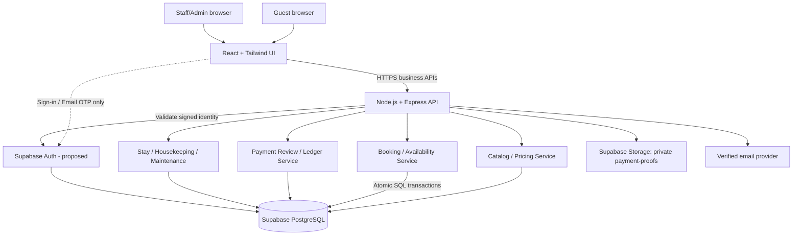

# 06 — High-Level System Architecture

## Component view

## Deployment boundaries

- Supabase **hosts PostgreSQL** and may provide Auth and Storage; our React UI and **separate Express API** run on their own hosts. Do not assume Supabase automatically deploys Express.
- React may call Supabase Auth to establish/refresh a user session. All hotel-domain reads/writes go through Express, including guest access control and staff actions.
- Express validates Supabase Auth identity with trusted server-side verification, then verifies actual staff membership, active status, role and reservation ownership in application data. Never trust `role` from user-submitted JSON.
- Guest OTP verification can use the managed Supabase Auth email OTP workflow with rate limits and no registered profile requirement; do not claim a Supabase Auth identity is literally a no-database-record guest.
- GCash is **not a payment gateway integration**: QR and payment proof are evidence only. Staff checks actual GCash account and explicitly records confirmation; no webhook and no automatic refunds.
- Private proof object keys remain in application records; access via controlled, time-limited signed URLs. Hotel promotional media/public QR may use separate public bucket when approved.

## Critical design: transactionally feasible category allocation

Category booking does **not** reveal a physical room number to the guest. Under a consistent **PostgreSQL category/room lock within the same transaction**, evaluate committed bookings, active holds, maintenance blocks and turnover buffers. A feasible physical allocation can be tracked internally while staff later selects the visible room assignment.

- **Invariant INV-01:** No two active commitments (including proof-protected holds) occupy one physical room at overlapping occupancy-plus-turnover times.
- Transaction logic must execute with server-side Postgres SQL/RPC that preserves the atomic boundary. **Do not compose availability decisions from separate Supabase REST calls.**
- PostgreSQL direct connections are suitable for persistent Express workers on IPv6; on IPv4-only hosting use Supabase's **session-mode pooler**. Transaction-mode pooler is generally for serverless workers and has session/prepared-statement constraints. Read the actual project's **Connect** dialog; don't invent database hostnames.
- Timeouts, retries and lock ordering must be integration tested with simultaneous online/walk-in attempts. Maintenance state changes must flag affected future reservations.

## Keep state machines separate

- `reservation.status`: parent lifecycle, may be partially cancelled or partially checked in.
- `room_booking.status`: each individual room item's own confirmed/check-in/checkout/cancel/no-show lifecycle.
- `payment_review.status`: screenshot awaiting/submitted/verified/disputed/rejected; staff verification is not delegated to Auth.
- `physical_room.status`: ready/occupied/cleaning/maintenance.
- `inventory_claim.status`: held/proof_pending_review/confirmed/released; a proof-pending claim is **not** auto-released at the original 30-minute deadline.

## Reliability and authorization

1. Use immutable financial charge/payment/refund records with explicit reversal entries, centavos only.
2. Server-generated timestamps; idempotent verification, refund and hold operations.
3. RLS for any exposed Supabase data surface; **secret keys bypass RLS**, therefore the Express layer must perform mandatory domain authorization for every request.
4. Log named staff actions and queue notifications separately from booking transactions.
5. Never store sensitive proof files in public buckets.

See [[22-supabase-setup]] · [[graphify/architecture-map]] · [[graphify/booking-lifecycle]].
