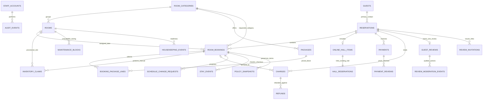

# 07 — Database Schema: Conceptual Model

## Unified Online Booking schema extension - 2026-11-21

The implementation adds a parent reservation relationship for the existing Hall item and immutable payment allocations for room and Hall costs. A Hall-only reservation may contain zero room bookings; all online reservations contain at least one bookable item. Hall claims remain in the exclusive Hall inventory and never consume bedroom inventory. The existing reservation payment/proof/reference registry is authoritative; do not create a second Hall receipt for the same original GCash transaction. Separate staff-managed Hall receipts remain supported.

Additive candidate SQL must preserve previous migrations, private tables/RLS/client denial, active staff checks, immutable price/confirmation evidence, item refund caps and transaction rollback. Cross-resource locks cover both claims; proof protection and expiry use one deadline. Item cancellations/reschedules/extensions cannot mutate siblings or reset cancellation eligibility. Candidate migration names and executed local database evidence are recorded in [[unified-online-booking-requirements-sync]]; no hosted application is authorized.

**Status:** Architecture blueprint only; **not** a tested SQL migration. Implementation may refine field names and indexes if documented in an ADR.

## Entity and relationship sketch

## Core tables (suggested)

| Table | Essential columns and rules |
|---|---|
| `staff_accounts` | `auth_user_id` linked to `auth.users.id`, staff display name, active flag, created_at; permission role is enforced server-side. **No local password hashes.** |
| `guests` | id, legal/display name, email, phone, verified_contact_at; minimization rules |
| `room_categories` | id, code, name, standard_occupancy_note, active; **not** unverified legal_max |
| `rooms` | id, category_id, code(unique), operational_state, active; physical room numbers to obtain from hotel |
| `packages` | id, category_id, duration_minutes, price_centavos, active, version; unique active category/duration (no Family 180m) |
| `reservations` | id, public_reference, guest_id, channel, status, online_confirmation_at, free_cancel_expires_at, created_at |
| `room_bookings` | id, reservation_id, category_id, assigned_room_id nullable, start_at, end_at, actual_checkin_at, actual_checkout_at, status, adult_count, child_count, pricing_snapshot_json |
| `booking_package_lines` | id, room_booking_id, package_version/id, duration_minutes, quantity, unit_price_centavos, line_total_centavos; ordered combination |
| `inventory_claims` | id, room_booking_id or checkout_session_id, room_id provisional nullable, category_id, claim_start_at, buffered_end_at, state, proof_deadline_at; transactional availability |
| `holds` | id, reference, guest/session id, cart version, status, created_at, proof_deadline_at, proof_submitted_at, expires_at; claim references |
| `charges` | id, reservation_id, room_booking_id nullable, type(base/extra_bed/overtime/smoking/extension/adjustment), amount_centavos, approved_by nullable, reason nullable, created_at |
| `payments` | id, reservation_id, method(cash/gcash), amount_centavos, status(pending_review/verified/rejected), received_at, verified_by, transaction_reference (GCash unique when verified) |
| `payment_reviews` | id, payment_id, proof_object_key, submitted_at, reviewer_id, decision_at, decision, notes, alert_state |
| `refunds` | id, reservation_id, room_booking_id nullable, charge allocation, requested_amount_centavos, approved_amount_centavos, transfer_reference, recipient_verified_at, processed_by, status |
| `schedule_change_requests` | id, item_id, proposed_start/end, requested_by, status, decision_by, decision_reason; approved transaction rewrites item interval and claim |
| `stay_events` | id, room_booking_id, event_type, event_at, actor_id, reason, elapsed_minutes; covers checkin, checkout, waiver, no-show, extension |
| `maintenance_blocks` | id, room_id, start_at, end_at nullable, reason, status, reported_by, cleared_by, outcome |
| `housekeeping_events` | id, room_id, event_type, timestamp, staff_id; physical Ready only via explicit action |
| `policy_snapshots` | id, scope room_booking or reservation, cancel policy, price terms, terms_ack_at; immutable |
| `guest_verification_events` | id, guest/reservation scope, verified `auth_user_id` or signed contact claim, purpose, verified_at, expiry/revocation metadata; Supabase Auth owns OTP generation/verification for this implementation. |
| `audit_events` | id, actor_user_id, subject_type/id, action, before_json, after_json, reason, created_at, correlation_id |
| `notification_outbox` | id, event_type, entity_id, payload, attempts, next_attempt_at, sent_at |
| `guest_reviews` (Phase 08) | id, reservation_id **UNIQUE** (one public rating per stay), primary_guest_id, stars (`CHECK` 1–5), optional comment, status(published/flagged/hidden), submitted_at, publicly_displayed_alias; eligible only from server-confirmed checked-in and checked-out booking | 
| `review_invitations` (Phase 08) | id, reservation_id, guest_id/contact binding, **hashed** opaque single-use token, expires_at, consumed_at, issued_at, delivery_status; no plain token stored | 
| `private_feedback` (Phase 08) | id, reservation_id, verified_guest_id, message, submitted_at, internal_status; restricted staff-only access and retention; separate from public average | 
| `review_moderation_events` (Phase 08) | id, review_id, actor_staff_id, action(flag/hide/restore/reply), policy_reason, before_state, after_state, happened_at; append-only audit |

## Constraints & migration requirements

- **Money:** use integer centavos (`BIGINT`/integer as appropriate); never store PHP float for computed totals.
- **Times:** PostgreSQL `timestamptz` for instants; user input interpreted with hotel timezone Asia/Manila.
- **No double booking:** transaction serialization plus testable feasibility allocation. For committed physical room claims use exclusion/constraint or equivalent overlap guarantee and consistent locking. `EXCLUDE USING gist (room_id WITH =, tstzrange(claim_start_at, buffered_end_at, '[)') WITH &&)` is one possible approach after designing status filtering (partial constraint); no magic roomless exclusion.
- `updated_at`, `created_by` and `version` fields for concurrency where appropriate. Financial events should be append-only or have explicit reversal instead of deleting transactions.
- **Account balance:** derived from charge/refund/payment journals rather than a manually editable number.
- **Extra bed:** itemized one-time charge per continuous stay; no automatic repeat when extension package appended.
- **Identity:** Supabase Auth manages secrets/sessions; application staff records reference `auth.users.id`. Guest verification is bound to the reservation, and authorization checks must not rely on public reference alone.
- **Storage:** payment screenshots live in a **private Supabase Storage bucket**, with only the object key in `payment_reviews`, controlled access and retention rules. Do not store signed URLs as permanent identifiers.
- **Multi-room:** reservation totals sum line items; cancellation and refunds must refer to the correct `room_booking_id` and preserve other active items.
- **Review integrity (Phase 08):** review entitlement requires an authorized reservation primary guest and a genuine recorded check-in plus completed checkout. Enforce **one public rating per reservation** with unique key + atomic server check. Rating 1–5 CHECK; public listing queries only eligible published reviews; do not include private feedback. Hash invitation tokens and prohibit replay. A published 1-star counts in aggregates unless validly hidden for a documented policy violation; never silently manipulate ratings. Moderation is reversible and audit-recorded.

## Implementation order

1. migrations for users/guests/categories/rooms/packages; 2. reservations/bookings/claims/holds; 3. payments/charges/**payment_reviews**/refunds; 4. stays/maintenance/audit/outbox; 5. **guest_reviews**, review invitations, private feedback and moderation events only in Phase 08. Lock and availability tests are mandatory before exposing writes.

See [[06-architecture]] · [[15-testing-plan]].

## Supabase integration note — v1.3

The schema is **not** migrated yet. Store application business tables in a dedicated application schema (`public` with carefully configured RLS or a separately exposed/restricted schema according to actual deployment); don't edit Supabase-owned `auth` or `storage` internal tables directly. `staff_accounts.auth_user_id` references `auth.users(id)` via supported PostgreSQL foreign-key conventions. Guest no-account verification can use managed Supabase Auth OTP with an internal auth identity but no persistent *registered guest profile*. Track data minimization and retention before release.

Use **versioned Supabase CLI SQL migrations** and generated TypeScript types. Booking claim atomicity remains a database-level requirement. See [[22-supabase-setup]].
