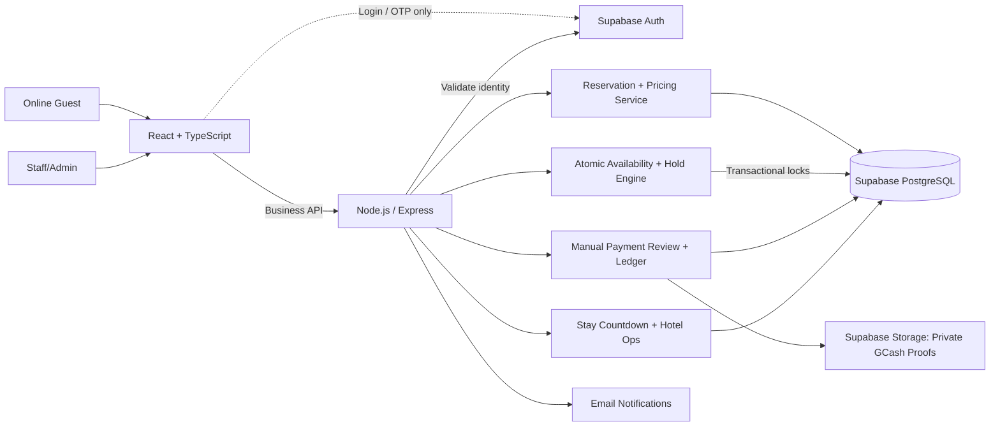

# Architecture Map — React, Express and Supabase

## Boundaries

- Browser cannot approve payment, release room claim or mutate room price.
- Supabase manages data/identity/file services; **separate Express API** retains business rules.
- All channels share one PostgreSQL inventory, with maintenance and cleaning buffers.
- Staff verifies actual GCash and manually handles refunds.
- One reservation may contain multiple independently scheduled room bookings.
- Payment proof uploads stay private; never expose secret key to browser.

See [[06-architecture]] · [[12-api-and-service-layer]] · [[22-supabase-setup]].
