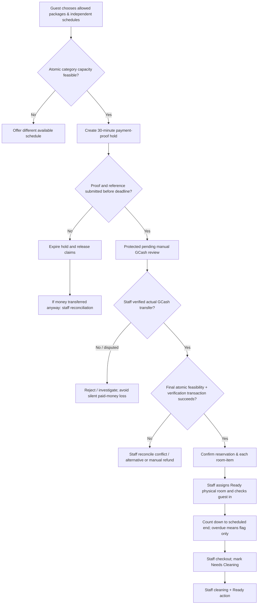

# Booking & Hold Lifecycle

**Timer dependencies:** On-time proof protects capacity past 30m; 15/30/60m review escalations don't auto-release. No-show after 1h arrival grace requires staff review. See [[04-feature-specification]].
