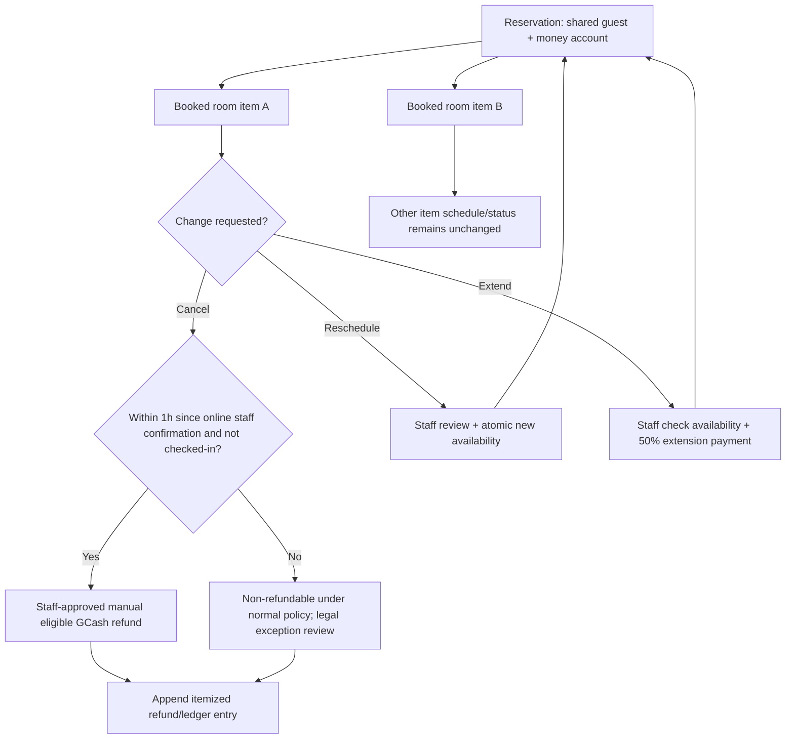

# Payment, Cancellation & Modification Flow

Refunds never execute automatically from an uploaded QR screenshot; staff logs verified recipient and transfer reference. Cancellation window is **not** renewed by rescheduling. See [[02-requirements]] and [[07-database-schema]].
