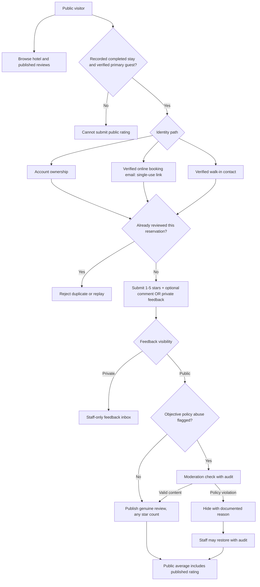

# Verified Guest Review Lifecycle

Diagram of approved Phase 08 guest reviews, public browsing, one-review-per-completed-reservation, and staff-only private feedback. This is a **proposed workflow**, not proof of implemented code.

Related specification: [[24-verified-guest-reviews]].
